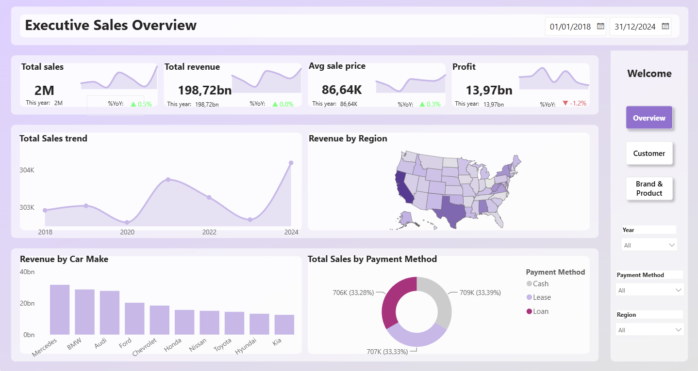
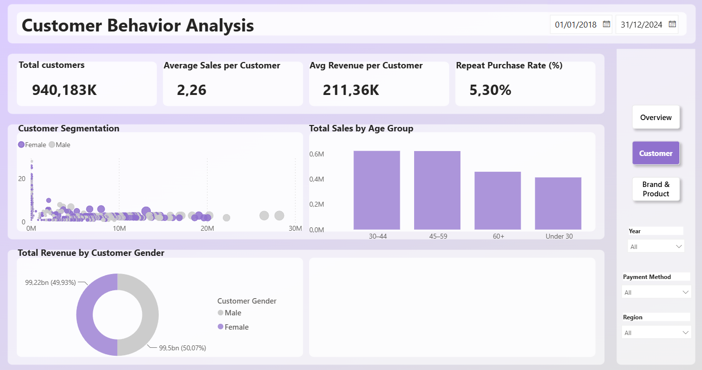
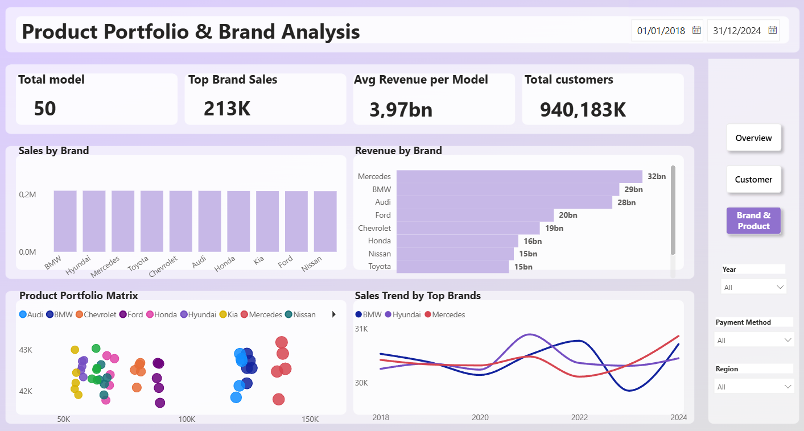

# USA Car Sales Power BI Analysis

## Project Overview

This project analyzes USA car sales data from 2018 to 2024 using Power BI.

The dashboard focuses on sales performance, revenue, profitability, customer behavior, product performance, payment methods, and regional trends.


## Dataset

The dataset contains more than 1 million car sales transaction records from 2018 to 2024.

Key fields include:

- Transaction Date
- Customer Information
- Car Make and Model
- Car Year
- Quantity
- Sale Price
- Cost
- Profit
- Discount
- Payment Method
- Commission
- Sales Region

### Data Source

Dataset: **USA Car Sales Dataset 2018–2024**  
Source: [Kaggle – USA Car Sales Dataset 2018–2024](https://www.kaggle.com/datasets/anjaliprajapati307/usa-car-sales-dataset-2018-2024)

### Data Limitations

- The original dataset contains inconsistencies between the `Date` field and the provided `Sale Year` field. Time-based analysis in this project therefore uses the `Date` field through `Dim_calendar`.
- The dataset does not provide a native customer ID. A surrogate `Customer_ID` was created from available customer attributes for analysis purposes.
- Some transactions contain unusually high sale prices, costs, or negative profits and should be treated as potential outliers.

## Data Model

The Power BI report uses a Star Schema with one central fact table and multiple dimension tables.

### Fact Table
- Fact_Sales

### Dimension Tables
- Dim_calendar
- Dim_Customer
- Dim_Product
- Dim_Market
- Dim_Payment
- Dim_Salesperson
## Dashboard Pages

### 1. Executive Sales Overview

The Executive Sales Overview provides a high-level view of overall business performance.

Key metrics include:

- Total Sales
- Total Revenue
- Average Sale Price
- Total Profit
- Year-over-Year Performance
- Sales Trend
- Revenue by Region
- Revenue by Car Make
- Sales by Payment Method



### 2. Customer Behavior Analysis

This page focuses on customer demographics and purchasing behavior.

Key analysis includes:

- Total Customers
- Average Sales per Customer
- Average Revenue per Customer
- Repeat Purchase Rate
- Customer Segmentation
- Customer Age Group
- Customer Gender



### 3. Product Portfolio & Brand Analysis

This page analyzes vehicle brands and product performance.

Key analysis includes:

- Total Models
- Top Brand Sales
- Average Revenue per Model
- Sales by Brand
- Revenue by Brand
- Product Portfolio Performance
- Sales Trend by Top Brands


## Tools Used

- Power BI
- Power Query
- DAX
- Data Modeling
- Data Visualization
- Git & GitHub

## Key Measures & DAX

Some of the main DAX measures used in this project include:

### Total Sales
```DAX
Total Sales =
SUM(Fact_Sales[Quantity])
```

### Total Revenue
```DAX
Total Revenue =
SUMX(
    Fact_Sales,
    Fact_Sales[Quantity] * Fact_Sales[Sale Price]
)
```

### Average Sale Price
```DAX
Average Sale Price =
AVERAGE(Fact_Sales[Sale Price])
```

### Total Profit
```DAX
Total Profit =
SUM(Fact_Sales[Profit])
```

### Profit Margin
```DAX
Profit Margin =
DIVIDE(
    [Total Profit],
    [Total Revenue],
    0
)
```

### Total Customers
```DAX
Total Customers =
DISTINCTCOUNT(Fact_Sales[Customer_ID])
```

## Key Insights

- More than **2 million vehicles** were sold across the analyzed period.
- Total revenue reached approximately **$198.72 billion**.
- Total profit reached approximately **$13.97 billion**.
- **Mercedes** generated the highest revenue among the analyzed car brands.
- Customer purchases were concentrated primarily in the **26–45 age groups**.
- Cash, Lease, and Loan represented the major payment methods, with a relatively balanced distribution.
- Sales performance remained relatively stable across the analyzed period, with **2024 recording the highest sales volume**.
- The analysis also identified potential outliers in transaction prices, costs, and profitability that should be considered when interpreting financial KPIs.

## Project Structure

```text
USA-car-sales-powerbi-analysis/
│
├── images/
│   ├── overview.png
│   ├── customer.png
│   └── brand-product.png
│
├── powerbi/
│   └── USA Car Sales 2018-2024.pbix
│
└── README.md
```

## Author

**Binh Phan**

GitHub: [BinhPhan172](https://github.com/BinhPhan172)